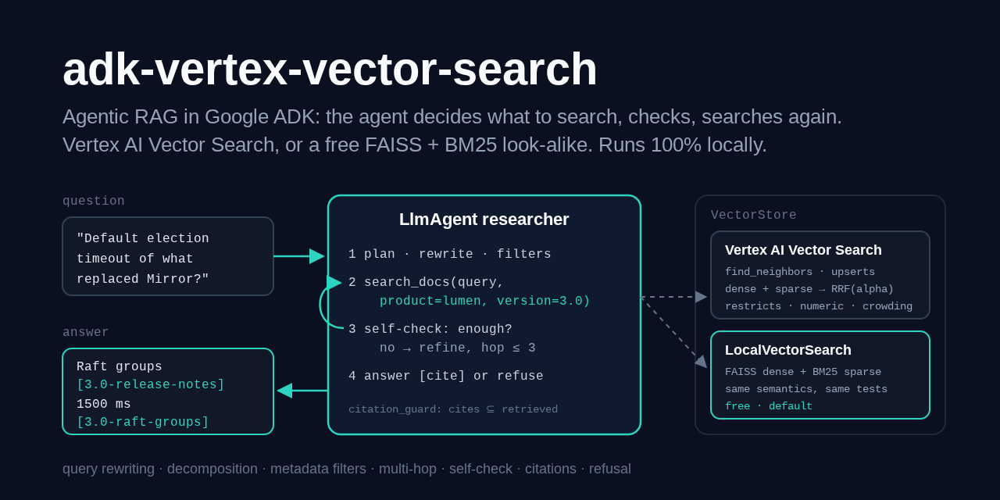
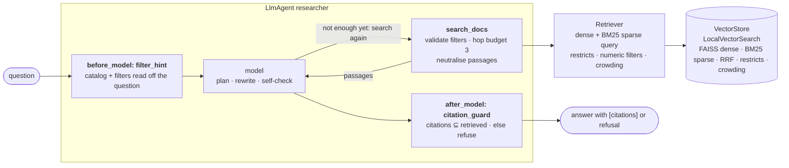

# adk-vertex-vector-search

> Agentic RAG in Google's [Agent Development Kit](https://adk.dev), built for **Vertex AI
> Vector Search**: an agent that decides when and what to retrieve. It rewrites the
> question into keyword queries, splits multi-part questions, searches with
> product/version/date **restricts**, checks whether the passages answer the question,
> searches again with a refined query when they don't (at most N hops), and answers with
> **citations** - or refuses. One `VectorStore` interface, two backends:
> `VertexVectorSearchStore` (`find_neighbors`, streaming upserts, hybrid dense + sparse
> with RRF, token and numeric restricts, crowding) and `LocalVectorSearch`, a free
> look-alike on FAISS + BM25 with the same semantics, proven by one contract test suite.

[](https://github.com/MartinCastroAlvarez/adk-vertex-vector-search/actions/workflows/ci.yml)
[](LICENSE)
[](pyproject.toml)
[](https://pypi.org/project/google-adk/)
[](pyproject.toml)



**Runs 100% locally, no paid APIs required.** The agent runs on an open-weight model on
[ollama](https://ollama.com) (`qwen3:4b`) through ADK's `LiteLlm`; passages are embedded
on your CPU with [fastembed](https://github.com/qdrant/fastembed) (`BAAI/bge-small-en-v1.5`)
and indexed with [FAISS](https://github.com/facebookresearch/faiss) and BM25 in a folder
on your disk. Vertex AI Vector Search is a paid Google Cloud service: the adapter is real
and follows the current `aiplatform_v1` API, but nothing in this repo (tests, demo, CI)
ever calls it - the tests run it against fake GAPIC clients.
[docs/vertex-setup.md](docs/vertex-setup.md) shows how to point it at your own index.

## Why

- **One retrieval is often not enough.** "What is the election timeout of the feature that
  replaced Mirror?" needs two searches: first *what* replaced Mirror, then its timeout. A
  fixed retrieve-then-read chain gets one shot; an agent can look again.
- **Versions make similarity lie.** Product docs say "the default port is 7400" in 1.4 and
  "7410" in 2.0. Both passages are equally similar to the question; only a metadata
  filter (`version=2.0`) picks the right one. Vector Search filters *inside* the ANN
  search with token and numeric restricts; this agent extracts them from the question.
- **Keywords and meaning both matter.** Error codes (`LUM-104`) and setting names
  (`raft.election_timeout_ms`) are exact-match problems; paraphrases ("undo a bad deploy")
  are semantic ones. Hybrid search sends a BM25 sparse vector and a dense embedding in
  one query and fuses the rankings with RRF.
- **Citations must be checkable.** The model may only cite passage ids that its own
  searches returned in this question; anything else is stripped, and an answer with no
  valid citation becomes a refusal. That is enforced in code, not asked for in a prompt.
- **The index should be a deployment choice.** Develop on a laptop for free, switch to
  Vertex with `RAG_STORE=vertex`, keep one test suite for both.

## Quickstart

```bash
pip install "adk-vertex-vector-search @ git+https://github.com/MartinCastroAlvarez/adk-vertex-vector-search"
ollama pull qwen3:4b
python -m agentic_rag "What is the default port in Lumen 2.0?"      # builds the local index on first use
python -m agentic_rag --provider stub --demo                         # offline: five questions, no model
python -m agentic_rag --bench                                        # recall@k / MRR per ranking mode
```

`--search` only retrieves (and prints the filters it read off the question), `--ingest
[DIR]` rebuilds the index from your own Markdown docs, `--json` prints machine-readable
output, `--mermaid` prints the graph below. `python -m examples.quickstart` runs the demo
offline and checks it. From a clone, `adk web .`, `adk run agentic_rag` and `adk eval
agentic_rag evals/agentic_rag.evalset.json --config_file_path evals/test_config.json`
work as is.

## The agent

`python -m agentic_rag --mermaid`, generated from the real agent and the configured store:



| Piece | ADK API | What it does |
| --- | --- | --- |
| `researcher` | `LlmAgent` | plans, rewrites the question into keyword queries, picks filters, reads results, decides whether to search again, answers with `[passage-id]` citations or the refusal sentence |
| `search_docs` | `FunctionTool` | one filtered hybrid search; validates the model's filters against the catalog, counts hops per question and refuses past the budget, neutralises passage text, records which ids came back |
| `filter_hint` | `before_model_callback` | appends the catalog (products, versions, doc types) and the filters `extract_filters` reads off the question ("Lumen 2.0" -> `product=lumen, version=2.0`; two versions -> "search each separately") |
| `citation_guard` | `after_model_callback` | keeps only citations retrieved in this invocation, appends a `Sources:` list, turns an uncited answer into a refusal, and stops a model that keeps searching after the budget is spent |

**Why a `FunctionTool` and not ADK's `VertexAiRagRetrieval`.** That tool targets Vertex AI
**RAG Engine** corpora; on Gemini it becomes a *built-in* retrieval the model runs
server-side: no visible tool call, no per-call restricts, numeric filters, crowding or
RRF weight, no hop count, no passage ids to check citations against, and no local or
non-Gemini path. Agentic RAG needs every one of those, so retrieval is a plain function
call the model chooses to make. (If you already run RAG Engine and want "retrieve, then
answer" on Gemini, `VertexAiRagRetrieval` is less code.)

## A run, five questions

`python -m agentic_rag --provider stub --demo`. **The replies come from
`OfflineResearcher`, a rule-based stub, not an LLM**: it reads what a model would read
(the question, the filter hints, the `search_docs` results) and follows the same loop
with plain rules, so the control flow is visible without ollama. Searches, filters,
hops, citations and the guard are the real code.

~~~text
=== 1. filters from the question
> What is the default port in Lumen 2.0?
  hop 1: search_docs('port'; product=lumen, version=2.0) -> 5 passages
Lumen 2.0: `port` defaults to 7410 in Lumen 2.0 (it was 7400 in 1.x). [lumen-2.0-configuration#network-settings.0]

Sources:
- [lumen-2.0-configuration#network-settings.0] Lumen 2.0 configuration reference - Network settings

=== 2. decomposition: one filtered search per version
> What is the default port in Lumen 1.4 and in Lumen 3.0?
  hop 1: search_docs('port'; product=lumen, version=1.4) -> 5 passages
  hop 2: search_docs('port'; product=lumen, version=3.0) -> 5 passages
Lumen 1.4: `port` sets the TCP port of the server and defaults to 7400. [lumen-1.4-configuration#network-settings.0] Lumen 3.0: `port` defaults to 7410 and `bind` to `127.0.0.1`. [lumen-3.0-configuration#network-settings.0]

=== 3. multi-hop: find the replacement first, then search for it
> What is the default election timeout of the feature that replaced Mirror replication?
  hop 1: search_docs('mirror replication replaced'; no filters) -> 5 passages
  hop 2: search_docs('Raft groups election timeout'; product=lumen, version=3.0) -> 5 passages
Lumen 3.0: Lumen 3.0 replaces Mirror replication with Raft groups, which replicate every write to a majority of servers before acknowledging it. [lumen-3.0-release-notes#highlights.0] Lumen 3.0: A follower that hears nothing for `raft.election_timeout_ms`, which defaults to 1500 milliseconds, starts an election. [lumen-3.0-raft-groups#election-timeout-and-heartbeats.0]

=== 4. self-check fails, the filter is relaxed and the agent searches again
> How do I list the releases on each host in Ferry 2.0?
  hop 1: search_docs('list releases host'; product=ferry, version=2.0) -> 5 passages
  hop 2: search_docs('list releases host'; product=ferry) -> 5 passages
Ferry 1.0: `ferry releases` lists the releases on each host with their id, git commit and the time they were deployed. [ferry-1.0-rollbacks#listing-releases.0]

=== 5. refusal: nothing in the docs supports an answer
> What is the capital of France?
  hop 1: search_docs('capital france'; no filters) -> 5 passages
I can't answer that from the documentation.
~~~

(`Sources:` lists trimmed after the first answer.)

## How it works

### The corpus

`agentic_rag/corpus/` holds 23 self-written Markdown docs for two **fictional** products
across three versions each, so filters matter: **Lumen** (an embedded key-value
database: 1.4, 2.0, 3.0) and **Ferry** (a deploy CLI: 1.0, 1.5, 2.0), as guides,
references, release notes and troubleshooting pages. Facts change between versions (the
port moves from 7400 to 7410, passwords become tokens become mutual TLS, Mirror
replication is replaced by Raft groups, canary deploys by progressive rollouts), and
release notes link the versions, which is what makes multi-hop questions possible.

### Ingestion: chunk, embed, upsert with restricts

`agentic-rag --ingest` (or the first question) runs `retrieval/ingest.py`:

1. **Chunk** by `##` section; a section over 700 characters is split on sentences with one
   sentence of overlap. Ids are stable: `<doc>#<section>.<n>`, e.g.
   `lumen-2.0-configuration#network-settings.0`.
2. **Embed** twice: a dense vector (title + section + text, fastembed by default) and a
   **BM25 sparse vector** - each term's BM25 weight at a stable 64-bit hashed dimension,
   so that `query · document` *is* the BM25 score on either backend.
3. **Upsert** one `Datapoint` per chunk with token restricts `product`, `version`, `major`,
   `doc_type`, numeric restricts `version_num` (`200`) and `released` (`20250120`), and
   `crowding_tag = doc id`. Re-ingesting upserts the same ids and removes vanished ones.

### Retrieval: one Vector Search query

```python
Query(
    feature_vector=embedder.embed_query(text),         # dense
    sparse_embedding=bm25.encode_query(text),          # sparse
    restricts=(Restrict("product", ("lumen",)), Restrict("version", ("2.0",))),
    numeric_restricts=(NumericRestrict("released", value_int=20250101, op="GREATER_EQUAL"),),
    neighbor_count=5,
    per_crowding_attribute_neighbor_count=2,           # at most 2 passages per document
    rrf_alpha=0.5,                                     # 1 = dense only, 0 = sparse only
)
```

`retrieval/types.py` mirrors `IndexDatapoint` / `FindNeighborsRequest.Query` field for
field. The semantics both stores implement, from the Vector Search filtering and hybrid
search docs: restricts are AND across namespaces and OR within one; a deny token excludes
any datapoint that has it; an empty query namespace matches everything, an absent
datapoint namespace matches nothing; every numeric restrict must hold
(`LESS`...`NOT_EQUAL`) on a value of the same type; filtering happens inside the search,
so a selective filter still returns `neighbor_count` results; RRF merges the dense and
sparse rankings weighted by alpha; crowding caps results per tag.

| `RAG_STORE` | Class | Dense | Sparse | Cost |
| --- | --- | --- | --- | --- |
| `local` (default) | `LocalVectorSearch` | FAISS `IndexFlatIP` (exact) or `IndexHNSWFlat` (`RAG_INDEX=hnsw`) with an `IDSelectorBatch` for the filters | inverted index, dot product | free; two files on disk (`vectors.npy` loaded without pickle, `datapoints.json`) |
| `vertex` | `VertexVectorSearchStore` | `MatchServiceClient.find_neighbors` on the endpoint's public domain | same request, `rrf.alpha` | paid, your project |

### The loop and what the code enforces

The instruction tells the model to plan, rewrite, filter, self-check and cite. A small
local model will not always follow it, so the parts that must hold are code:

- **Hop budget.** `search_docs` counts searches per question (`rag:trace` in session
  state, reset per invocation). After `RAG_MAX_HOPS` it returns `hop_limit` instead of
  searching; if the model asks again, `citation_guard` ends the turn with the refusal.
  `RunConfig(max_llm_calls)` is the backstop.
- **Filters are checked.** An unknown product or version is an `invalid_filter` result
  listing the known values, so the model can correct itself.
- **Citations are checked.** Only ids returned by `search_docs` *in this question* count.
- **Passages are data.** Each passage is neutralised before the model sees it
  (instruction-like sentences withheld, markup defused).

## Retrieval benchmark

`python -m agentic_rag --bench`: 50 questions over the 73 chunks
([`corpus/qa.jsonl`](agentic_rag/corpus/qa.jsonl), each labelled with the sections that
answer it; 8 are paraphrases with little word overlap). Recall@k is the share of a
question's relevant sections in the top k (many questions have two, so recall@1 is
capped below 1); MRR@10 is the mean reciprocal rank of the first relevant one. Crowding is
off for the benchmark. A real run on a 14-core ARM64 Linux box, CPU only:

**fastembed `BAAI/bge-small-en-v1.5` (384 dimensions, the default)**

| config | recall@1 | recall@3 | recall@5 | MRR@10 | ms/query |
|---|---|---|---|---|---|
| dense | 0.677 | 0.863 | 0.883 | 0.883 | 81.8 |
| sparse (BM25) | 0.630 | 0.877 | 0.913 | 0.852 | 0.1 |
| hybrid (RRF, alpha 0.5) | 0.697 | 0.843 | 0.903 | 0.904 | 118.0 |
| hybrid + filters | **0.717** | **0.940** | **0.940** | **0.927** | 102.0 |

**hashing embedder (`RAG_EMBEDDER=hash`, offline, what CI runs)**

| config | recall@1 | recall@3 | recall@5 | MRR@10 | ms/query |
|---|---|---|---|---|---|
| dense | 0.517 | 0.793 | 0.870 | 0.757 | 0.1 |
| sparse (BM25) | 0.630 | 0.877 | 0.913 | 0.852 | 0.1 |
| hybrid (RRF, alpha 0.5) | 0.567 | 0.823 | 0.900 | 0.809 | 1.4 |
| hybrid + filters | **0.667** | **0.910** | **0.950** | **0.890** | 0.5 |

What it says: on versioned docs **the filters are worth more than the ranking method**
(+0.02 to +0.08 MRR and the best recall at every k on both embedders); hybrid beats either
ranking alone on MRR with a real embedding model; BM25 alone is a strong baseline on
technical text full of exact names and codes. Latency is dominated by embedding the query
on CPU. End to end, the offline stub agent (hash embedder, rules instead of an LLM) cites
a relevant section for 37 of the 50 questions.

## When to use this pattern / trade-offs

Use **agentic RAG** when questions are multi-part or multi-hop, when the corpus has
metadata that decides correctness (versions, products, dates, tenants), and when an
unsupported answer is worse than "I don't know". Use a plain retrieve-then-read chain
when questions are single-hop and latency or cost per question matters most.

| Choice | Gain | Cost |
| --- | --- | --- |
| Agent decides when/what to search (vs one fixed retrieval) | multi-hop, decomposition, recovery from a bad first query | more model calls per question; small models plan unevenly |
| Hop budget enforced in code | bounded latency and cost, no search loops | a hard question may be refused at the cap |
| Metadata restricts (vs pure similarity) | the right version, not the most similar one | needs clean metadata; a wrong filter hides the answer (hence "relax and retry") |
| Hybrid dense + BM25 (RRF) | exact codes and paraphrases both rank | two encoders; alpha to tune |
| Crowding by document | diverse passages, room for both versions | may drop a second relevant section of the same doc |
| Citation guard | no invented sources; uncited answers become refusals | the model must use the id format; it does not check the claim itself |
| Local FAISS + BM25 | free, offline, exact search | one process, in-memory; rebuilt from files on start |
| Vertex Vector Search | managed ANN at scale, streaming updates, autoscaling | paid by the hour while deployed; a cloud dependency |

Reach for **long-term memory** instead when the knowledge is facts about a user rather
than documents (see
[adk-vertex-memory-bank](https://github.com/MartinCastroAlvarez/adk-vertex-memory-bank)).

## Configuration

| Variable | Default | Meaning |
| --- | --- | --- |
| `RAG_PROVIDER` | `ollama` | `ollama`, `gemini` (your key) or `stub` (offline rules) |
| `RAG_MODEL` | `qwen3:4b` / `gemini-3.5-flash` | model id; ollama ids become `ollama_chat/<id>` |
| `OLLAMA_HOST` | `http://127.0.0.1:11434` | must be loopback unless the next variable is `1` |
| `RAG_ALLOW_REMOTE_OLLAMA` | unset | `1` allows a non-loopback ollama (model and embeddings) |
| `RAG_STORE` | `local` | `local` or `vertex` (paid, your project) |
| `RAG_INDEX_DIR` | `~/.cache/adk-vertex-vector-search` | local index, catalog and model cache (mode 0700) |
| `RAG_INDEX` | `flat` | local dense index: `flat` (exact) or `hnsw` (approximate) |
| `RAG_EMBEDDER` | `fastembed` (`hash` for `stub`) | `fastembed`, `ollama`, `hash` or `vertex` (paid) |
| `RAG_EMBED_MODEL` | `BAAI/bge-small-en-v1.5` | per embedder: `nomic-embed-text`, `gemini-embedding-001` |
| `RAG_EMBED_DIMENSIONS` | `768` | output dimensions for the Vertex embedder (= index dimensions) |
| `RAG_MAX_HOPS` | `3` | searches per question |
| `RAG_TOP_K` | `5` | passages per search |
| `RAG_ALPHA` | `0.5` | RRF weight: 1 = dense only, 0 = sparse only |
| `RAG_PER_DOCUMENT` | `2` | crowding: passages per document per search |
| `RAG_VERTEX_PROJECT`, `_LOCATION`, `_INDEX`, `_INDEX_ENDPOINT`, `_DEPLOYED_INDEX`, `_ENDPOINT_DOMAIN` | unset | the deployed index, for `RAG_STORE=vertex` ([setup](docs/vertex-setup.md)) |
| `GOOGLE_API_KEY` | unset | only for `RAG_PROVIDER=gemini`; read by ADK, never by this package |

## Testing

```bash
poetry install && poetry run pytest          # 209 tests, 97% coverage, offline
```

- **Contract suite** (`tests/test_contract.py`), every test run twice: on
  `LocalVectorSearch`, and on `VertexVectorSearchStore` talking to
  `tests/fake_vector_search.py` - fake `IndexServiceClient` / `MatchServiceClient` that
  take and return real `aiplatform_v1` protos and implement the documented semantics
  independently (no shared code). Dense ranking, batches, allow/deny/AND/OR restricts,
  empty and missing namespaces, all six numeric operators and type mismatches, sparse
  dot products, RRF with alpha 0/0.5/0.1/1, crowding, upsert-replaces, remove, filtered
  search that doesn't starve, and the retriever end to end.
- **Agent control flow** (`tests/test_agent.py`) with a scripted `BaseLlm`: filters read
  off the question reach the store as the exact restricts; major versions, since-version,
  dates and doc types become restricts and numeric filters; multi-hop when the first
  retrieval is insufficient; parallel decomposed searches all count; the hop cap stops a
  model that keeps searching (two searches, a `hop_limit`, a refusal); citations only from
  chunks retrieved in this question; an uncited answer, an answer without searching and
  "not in the docs" all end as the refusal; invalid filters are correctable errors; an
  injected passage reaches the model neutralised.
- **Vertex requests** (`tests/test_vertex.py`): the exact `UpsertDatapointsRequest` (batches
  of 100, int64 sparse dimensions, no `op` on stored numeric restricts, crowding tag),
  `FindNeighborsRequest` (endpoint, deployed index, `rrf.alpha` only for true hybrid
  queries, crowding, approximate count), `RemoveDatapointsRequest`, ingestion that removes
  vanished chunks, malformed resource names refused, no implicit Vertex ingestion, and
  `import agentic_rag` loading no Cloud SDK (subprocess check). An autouse fixture makes
  `google.auth.default()` and `httpx.post` fail any test that calls them.
- ADK's own evaluator on a recorded eval set (trajectory + response), the offline demo,
  filters, chunking, BM25, embedders against fakes, the local index files (no pickle),
  config, the CLI and hygiene (no `eval`/`pickle`/`subprocess`/`shell=`, no silenced lint).
  CI also runs `adk run`, `adk eval`, `adk web` (a two-hop `/run`) and the benchmark.

## Part of the series

| Repo | Framework | Architecture |
|---|---|---|
| [langgraph-parallel-agents](https://github.com/MartinCastroAlvarez/langgraph-parallel-agents) | LangGraph | Parallelization / map-reduce (fan-out, fan-in) |
| [langgraph-plan-and-execute](https://github.com/MartinCastroAlvarez/langgraph-plan-and-execute) | LangGraph | Planning (plan → execute → replan) |
| [langgraph-reflection-agent](https://github.com/MartinCastroAlvarez/langgraph-reflection-agent) | LangGraph | Reflection (Reflexion: draft → critique → revise) |
| [langgraph-short-long-term-memory](https://github.com/MartinCastroAlvarez/langgraph-short-long-term-memory) | LangGraph | Memory: short-term (checkpointer) vs long-term (store) |
| [adk-sequential-pipeline](https://github.com/MartinCastroAlvarez/adk-sequential-pipeline) | Google ADK | Sequential pipeline + generator↔critic loop |
| [adk-vertex-memory-bank](https://github.com/MartinCastroAlvarez/adk-vertex-memory-bank) | Google ADK | Long-term memory (Vertex AI Memory Bank) |
| ✅ **adk-vertex-vector-search** | Google ADK | Agentic RAG (Vertex AI Vector Search) |
| [crewai-hierarchical-planning](https://github.com/MartinCastroAlvarez/crewai-hierarchical-planning) | CrewAI | Hierarchical / supervisor with planning |
| [langchain-tag-agent](https://github.com/MartinCastroAlvarez/langchain-tag-agent) | LangChain | Tool-using ReAct agent with Table-Augmented Generation (TAG) |
| [langsmith-agent-evals](https://github.com/MartinCastroAlvarez/langsmith-agent-evals) | LangSmith + LangGraph | Evaluation / observability, LLM-as-judge critic |
| [agentic-architectures](https://github.com/MartinCastroAlvarez/agentic-architectures) | framework-free | Catalog: ReAct, router, sequential, parallel, loop, reflection, critic, planning, supervisor, swarm/handoff, debate, human-in-the-loop, memory |
| [s3-agent-memory](https://github.com/MartinCastroAlvarez/s3-agent-memory) | LangGraph store | Agent memory (long-term, S3) |
| [agent-model-router](https://github.com/MartinCastroAlvarez/agent-model-router) | — | Router |

More from the same author: [local-rag-ollama](https://github.com/MartinCastroAlvarez/local-rag-ollama) ·
[ui-review-agent](https://github.com/MartinCastroAlvarez/ui-review-agent) ·
[pytest-llm-evals](https://github.com/MartinCastroAlvarez/pytest-llm-evals) ·
[repo-graph-mcp](https://github.com/MartinCastroAlvarez/repo-graph-mcp) ·
[agent-lint](https://github.com/MartinCastroAlvarez/agent-lint) ·
[django-admin-mcp-api](https://github.com/MartinCastroAlvarez/django-admin-mcp-api).

## Contributing

See [`CONTRIBUTING.md`](CONTRIBUTING.md), [`ARCHITECTURE.md`](ARCHITECTURE.md),
[`SECURITY.md`](SECURITY.md) and the agent contract in [`CLAUDE.md`](CLAUDE.md).

## License

MIT © 2026 Martín Castro Álvarez. See [LICENSE](LICENSE).
